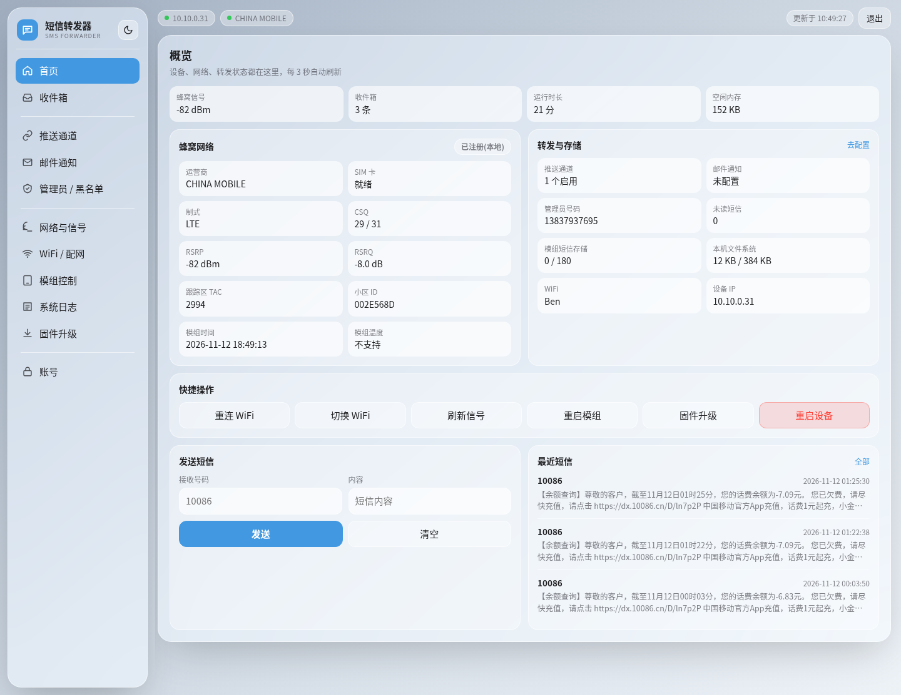
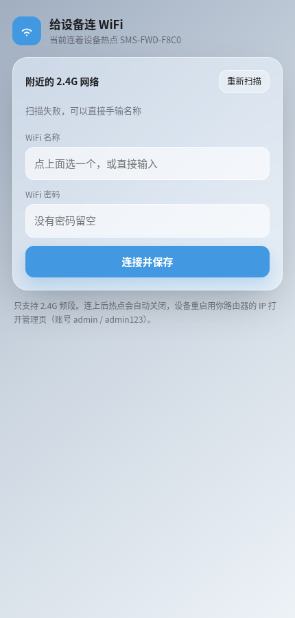
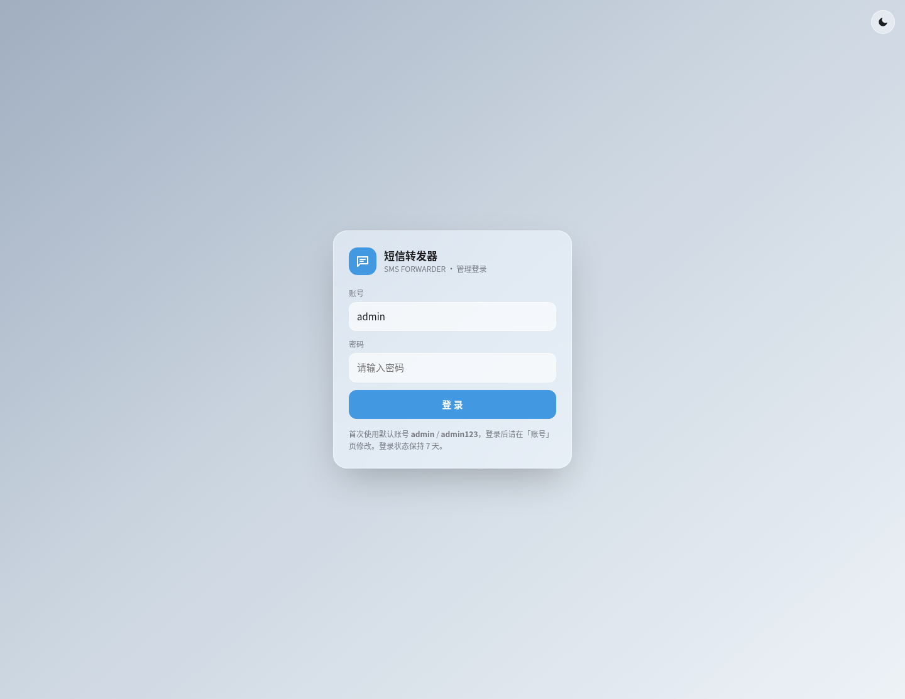
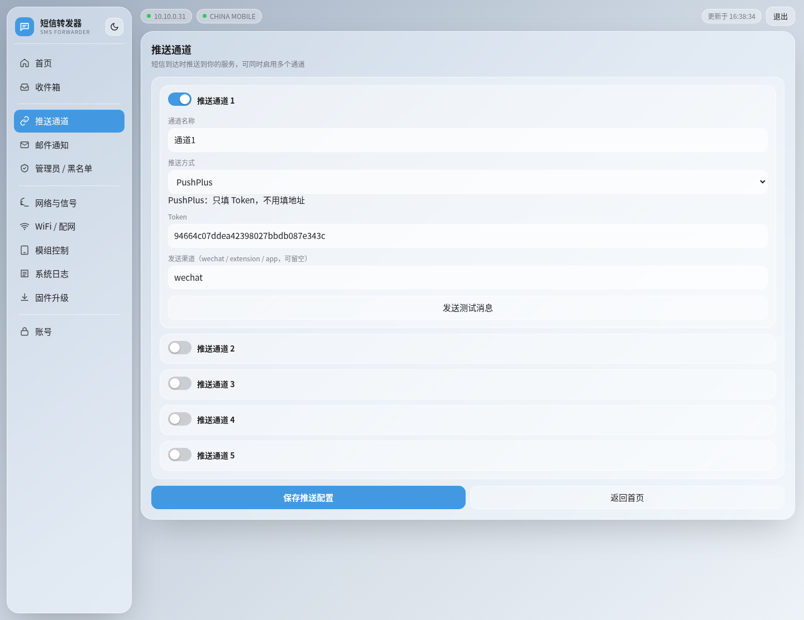
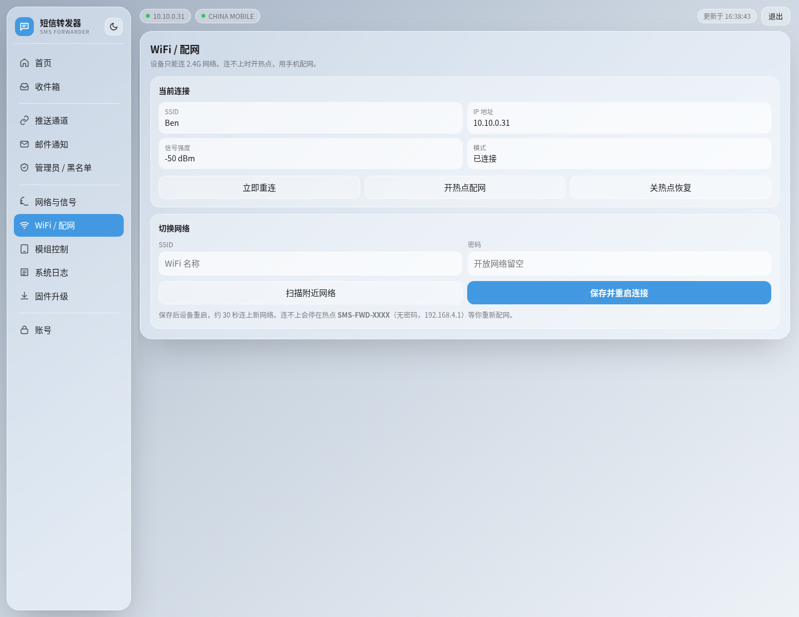

# 📨 短信转发器 / SMS Forwarder

> 一块 ESP32-C3 + 一张流量卡，把手机短信自动推到微信 / 邮件 / Webhook。
> An ESP32-C3 board with a 4G module that forwards incoming SMS to WeChat, email or any webhook.


**[中文](#-简介--overview) · [English](README_EN.md)**



---

## 📖 简介 / Overview

**中文**

整机成本不到 30 块：ESP32-C3 负责联网和网页控制台，ML307R-DC 负责驻网收短信。设备把收到的短信推到微信（PushPlus / Server酱 / 企业微信机器人）、邮件、Bark、飞书、钉钉或任意 HTTP 接口，同时存一份到本地收件箱。

不需要装 Arduino IDE：浏览器打开在线刷写页点一下就能把固件写进设备；之后的升级在设备网页里上传一个 `.bin` 就行，配置和收件箱都不丢，出问题自动回滚。

**English**

Under $5 of hardware: an ESP32-C3 runs the web console and WiFi, an ML307R-DC module holds the SIM and receives SMS. Every incoming message is forwarded to WeChat (PushPlus / ServerChan / WeCom bot), email, Bark, Feishu, DingTalk or any HTTP endpoint, and archived locally.

No Arduino IDE required — flash it from the browser, then upgrade by uploading a single `.bin` in the device's own web UI. Config and inbox survive upgrades, failed boots roll back automatically.

---

## ✨ 特性 / Features

- 📲 **免 IDE 刷机** — ESP Web Tools 在线刷写，Chrome / Edge 点一下即可；固件是**单个 `.bin`**
- 🔄 **双系统槽 OTA** — 网页上传 `.bin` 即升级（整包与纯应用镜像自动识别），保留 WiFi / 推送 / 邮件 / 收件箱；连续 3 次启动失败自动回滚
- 📶 **真配网流程** — 首刷后设备是空配置，开无密码热点并启动强制门户（captive portal），手机连上自动弹配网页
- 🧠 **短信不丢** — 单串口调度器（URC 与 AT 响应不抢缓冲区）、长短信合并、模组存储自动归档清空
- ⚡ **主循环不卡** — 推送与邮件在独立后台任务里发，发短信是状态机；慢网络也不会让网页转圈或丢短信
- 🗂️ **本地收件箱** — LittleFS 存 300 条，支持分页、搜索、已读标记、删除
- 🔀 **10 种推送方式** — 5 个通道可同时启用，字段随类型自动切换，每个通道带「发送测试消息」
- 📮 **邮件转发** — SMTP（ReadyMail），支持 SSL/STARTTLS
- 🖥️ **玻璃拟态控制台** — 首页聚合全部状态 + 快捷操作 + 直接发短信，其余功能独立分页；深浅双主题，手机端自适应
- 🔐 **页面登录** — Cookie 会话（HttpOnly，7 天）+ CSRF 双提交校验，不再弹浏览器原生认证框
- 🛡️ **可选证书校验** — 填了 TLS 根证书就真校验证书链（SMTP / HTTPS 推送），不填也会在页面上写明风险
- 📩 **远程管理** — 管理员号码发 `STATUS` / `WIFI` / `LOG` / `SMS:` / `RESET` / `HELP`，结果邮件回执
- 🧪 **网络自测** — 模组侧 `AT+MPING` 实测连通性，默认 `223.5.5.5`，可自定义目标与次数
- 🛠️ **CI 出包** — GitHub Actions 锁定版本编译，打 tag 自动发 Release

---

## 🚀 快速开始 / Quick Start

### 1️⃣ 准备硬件 / BOM

| 部件 | 型号 | 必需 |
|---|---|---|
| 主控 | ESP32-C3 SuperMini（4MB Flash） | ✅ |
| 4G 模组 | ML307R-DC 核心板（板载 Nano SIM 槽） | ✅ |
| 天线 | 4G FPC 天线，接模组 IPEX 座 | ✅ |
| SIM 卡 | 移动 / 联通 / 电信，开通短信功能即可 | ✅ |

> 💡 不需要流量套餐也能收短信；但「网络自测」和模组侧查询会走一点点流量，介意的话把数据连接关掉（固件默认 `AT+CGACT=0,1` 已关闭数据）。

### 2️⃣ 接线 / Wiring

```
┌───────────────────────────────────────────────┐
│   ESP32-C3 SuperMini      ML307R-DC 核心板     │
│ ┌───────────────────┐    ┌─────────────────┐  │
└─┼─ GPIO5 (MODEM_EN) │    │                 │  │
  │       GPIO3 (TX) ─┼───►│ RX              │  │
  │                   │    │             EN ─┼──┘
  │       GPIO4 (RX) ◄┼────┤ TX              │
  │              GND ─┼────┤ GND             │
  │               5V ─┼────┤ VCC (5V)        │
  └───────────────────┘    └─────────────────┘
```

ESP32 通过 USB 供电和刷机；模组跑出厂 AT 固件，不用动。

### 3️⃣ 刷固件 / Flash

**方式 A — 浏览器（推荐，无需装任何软件）**

1. 打开 <https://lzylipu.github.io/sms_forwarding/>
2. Chrome / Edge 点「连接设备并安装」，选串口
3. 约 1–2 分钟写完，设备自动重启

**方式 B — 命令行**

```bash
# 下载 Releases 里的 sms_forwarding.bin，然后：
esptool --chip esp32c3 -p COM4 write-flash 0x0 sms_forwarding.bin
```

**方式 C — Arduino CLI（自行编译）**

```bash
arduino-cli core install esp32:esp32@3.3.10
arduino-cli lib install "pdulib@0.5.11" "ReadyMail@0.4.2"
arduino-cli compile --fqbn esp32:esp32:makergo_c3_supermini \
  --build-property "upload.maximum_size=1835008" --output-dir out ./code
```

### 4️⃣ 配网 / Provision

刷完是「空机」——里面没有任何 WiFi 信息：

1. 上电后设备**立刻**开无密码热点 `SMS-FWD-XXXX`
2. 手机连上会自动弹「登录网络」，点开就是配网页；没弹就直接开 `http://192.168.4.1`
3. 页面进来自动扫描，选一个 **2.4G** 网络 → 填密码 → 连接并保存
4. 成功后设备重启连上路由器，热点关闭，页面显示新 IP



> ⚠️ 只支持 2.4G 频段。5G SSID 扫得到但连不上。

### 5️⃣ 登录 / Sign in

浏览器打开设备 IP → 跳转登录页，默认账号 `admin`，默认密码 `admin123`。

**第一次登录后请立刻到「账号」页改掉。** 会话存在 RAM，设备重启需重新登录。



### 6️⃣ 配一条推送 / Add a channel

「推送通道」→ 选方式（比如 PushPlus）→ 只填它要的字段（Token）→ 点该通道的「**发送测试消息**」。

页面会先静默保存，再让设备真发一条测试消息，直接给成功/失败结论——不用等真短信来验证。

测试消息的标题是「**[测试] 推送通道「通道1」连通正常**」，不会伪装成真实短信；真实短信的标题是「短信来自: 号码」，正文带「短信时间」。想预览真实短信在手机上长什么样，可以调 `POST /push/test?ch=0&async=1&raw=1`（见 [API 文档](docs/API.md)）。



---

## 🖥️ 设备网页 / Web Console

**首页**把所有状态聚在一屏：蜂窝信号、收件箱、运行时长、空闲内存、运营商 / SIM / 制式 / CSQ / RSRP / RSRQ / TAC / 小区 / 模组时间、转发与存储占用、6 个快捷操作、直接发短信、最近 3 条短信。

其余功能各自独立分页：**收件箱 / 推送通道 / 邮件通知 / 管理员&黑名单 / 网络与信号 / WiFi 配网 / 模组控制 / 系统日志 / 固件升级 / 账号**。



- 浅色 / 深色双主题，22px 圆角毛玻璃面板
- 按钮统一 `auto-fit` 网格，不会出现「三个挤一排、第四个单独换行」
- 手机端导航变成横向可滑动文字条，卡片单列

---

## 📮 推送与转发 / Push & Email

| 方式 | 需要配置 | 备注 |
|---|---|---|
| POST JSON | 推送地址 | 通用接口，body 为 `{sender,message,timestamp}` |
| Bark | Bark 地址（含 key） | iOS 推送 |
| GET 请求 | 完整请求地址 | 参数自动 URL 编码 |
| 钉钉机器人 | Webhook 地址 +（可选）加签 Secret | 文本消息 |
| PushPlus | Token +（可选）渠道 wechat/extension/app | 微信推送，HTML 正文 |
| Server酱 | SendKey | 微信推送，Markdown 正文 |
| Telegram Bot | Chat ID + Bot Token | — |
| Gotify | 服务器地址 + 应用 Token | 自建推送 |
| 飞书机器人 | Webhook 地址 | 文本消息 |
| 自定义模板 | 推送地址 + 请求体模板 | `{sender}` `{message}` `{timestamp}` |

**邮件**：支持 SMTP + SSL/STARTTLS，四个字段（服务器 / 端口 / 账号 / 授权码）+ 收件地址配齐后自动启用，配置不全自动跳过并写日志。

**TLS 证书校验（可选）**：「邮件通知」页底部有个「TLS 根证书（PEM）」框，SMTP 与 HTTPS 推送共用：

- 留空 → 只加密、不校验证书。适合家用局域网，页面会明确写出这个风险。
- 粘贴 CA 的 PEM → 走 `setCACert()` 真正校验证书链，防中间人。

> 想让 https 推送严格可信就把证书填上；只关心能不能收到消息的话留空即可。

**管理员远程指令**（从已登记的管理员号码发短信给本机）：

| 指令 | 作用 |
|---|---|
| `SMS:号码:内容` | 让设备替你发一条短信 |
| `STATUS` | 运行状态摘要（在线时长、内存、信号、收件箱） |
| `WIFI` | 当前 WiFi 与 IP |
| `LOG` | 最近 20 条设备日志 |
| `RESET` | 重启设备 |
| `HELP` | 列出全部指令 |

所有指令的执行结果都**通过邮件回执**，不回复短信（避免扣费）。所以远程管理依赖 SMTP 配好。

---

## 🧪 硬件能力实测 / Hardware Capability

在真实设备（ESP32-C3 SuperMini + ML307R-DC，模组固件 `ML307R-DC-MBRH0S00`）上逐条 `AT+XXX=?` 探测：

| 能力 | 结论 | 说明 |
|---|---|---|
| 短信收发 / PDU 模式 | ✅ 已用 | 长短信自动合并 |
| 模组侧短信存储 180 条 | ✅ 已用 | 后台自动归档清空 |
| 状态报告 `+CDS` | ✅ 可用 | 默认关闭 |
| 小区 / 跟踪区 / 制式 | ✅ 已用 | `+CEREG=2` 主动上报 |
| 模组时钟 `+CCLK` | ✅ 已用 | UTC + 时区换算成本地时间 |
| 芯片温度 | ⚠️ 不可用 | `+MCHIPINFO="temp"` 返回 `-1`，这版硬件无传感器 |
| `MADC` 两路 ADC | ✅ 可用 | 可接电池电压 / 热敏电阻 |
| `MGPIO` 4 个 IO | ✅ 可用 | 可接继电器、门磁 |
| `MLED` | ✅ 可用 | 模组板载 LED |
| `MNTP` / `MHTTP` / `MQTT` | ✅ 可用 | 模组侧可直接联网 |
| 模组 FOTA | ✅ 可用 | 支持差分与回滚，本项目未采用 |
| USSD（`*100#`） | ❌ 不支持 | `+CUSD` 返回 ERROR |
| 语音 / 来电显示 | ❌ 不支持 | `+CLIP` `+CLCC` `+CCWA` 全部 ERROR |
| LBS / 基站定位 | ❌ 不支持 | 仅 OpenCPU 方案才有 |
| GNSS / GPS | ❌ 不支持 | 该型号无定位硬件 |
| `AT+CLAC` 列出全部指令 | ❌ 不支持 | 只能逐条探测 |

> 📌 本项目**只做短信接收转发**。多卡、通话、拨号、开放外网接口等不在范围内。

---

## 📁 项目结构 / Structure

```
sms_forwarding/
├── code/                    # Arduino 固件
│   ├── code.ino             # 入口：初始化顺序 + 路由注册 + 主循环任务
│   ├── modem.cpp/.h         # 模组串口调度、AT 收发、URC 解析、短信取回
│   ├── sms_process.cpp/.h   # PDU 解码、长短信合并、转发分发
│   ├── sms_store.cpp/.h     # LittleFS 收件箱（JSONL + 去重 + 压缩）
│   ├── push.cpp/.h          # 10 种推送通道 + SMTP 邮件
│   ├── wifi_manager.cpp/.h  # NVS 凭据、AP/STA 切换、断线重连、看门狗
│   ├── portal.cpp/.h        # 强制门户：通配 DNS + 探测路径跳转
│   ├── ota.cpp/.h           # 双槽 OTA、启动计数、自动回滚
│   ├── web_handlers.cpp/.h  # 路由与接口实现、会话认证、分块渲染
│   ├── web_html.cpp         # 控制台页面（内联 CSS/JS，无 CDN）
│   ├── web_pages_a.cpp      # 登录页 / 配网页
│   └── partitions.csv       # 双系统槽分区表
├── scripts/package.sh       # 编译产物 → 单个 sms_forwarding.bin
├── docs/
│   ├── index.html           # 在线刷写页（GitHub Pages）
│   ├── ARCHITECTURE.md      # 架构与模块说明
│   ├── API.md               # HTTP 接口文档
│   ├── REVIEW.md            # 代码审查报告（缺陷清单 + 验证证据 + 已知限制）
│   └── fw/                  # 刷写页用的固件与清单（CI 自动同步）
├── assets/                  # 文档截图
└── .github/workflows/build.yml
```

---

## ⚙️ 构建与发版 / Build & Release

```bash
# 本地出包（产物是单个 .bin，0x0 整片可刷，也能直接给设备 OTA）
bash scripts/package.sh out 2.1.6 dist
```

CI（`.github/workflows/build.yml`）：

- 锁定 `esp32:esp32@3.3.10` / `pdulib@0.5.11` / `ReadyMail@0.4.2`
- 每次 push 编译出 `sms_forwarding.bin` 作为 artifact
- 打 `v*` tag → 创建 Release（只含这一个文件）+ 同步到 `docs/fw/` 供在线刷写页使用

---

## 🔧 故障排查 / Troubleshooting

| 现象 / Issue | 原因与解决 / Cause & Fix |
|---|---|
| 打开在线刷写页提示 `Failed to download manifest` | 清单被浏览器 CORS 拦了。本项目把清单和 bin 放在 Pages 同源目录（`docs/fw/`），刷新页面即可；自己部署时别指向 GitHub Release |
| 浏览器里找不到串口 | 用 Chrome / Edge（Safari、Firefox 不支持 Web Serial）；换一条能传数据的 USB-C 线；装 CH340/CP210x 驱动 |
| 连上热点不弹配网页 | 部分安卓机不主动探测。手动开 `http://192.168.4.1`，或打开任意 http 网址（门户 DNS 会把它指过来） |
| 扫描不到 WiFi | 只支持 2.4G；也可以直接手输 SSID。若在 AP 模式下扫描不到，先确认固件 ≥ 2.1.1 |
| 登录成功但页面回到登录页 | 固件 < 2.1.2 的 bug（请求头未采集，Cookie 读不到），升级到最新版 |
| 推送收不到 | 用该通道的「发送测试消息」按钮，再点「系统日志」看 `[通道N] 响应码` 与平台返回体；常见是 Token 错、平台额度用完 |
| 明明有短信但页面没收到 | 看「模组短信存储」是否接近 180；满了运营商会拒收，固件会自动归档清空，升级后观察 |
| 微信收不到 PushPlus | 正确填写的是 Token（不是 Topic），渠道填 `wechat` |
| 模组温度显示「不支持」 | 该型号无温度传感器，属正常 |
| 升级后配置丢了 | 只有「整片刷写」（0x0 写入）会清 NVS。用网页「固件升级」上传 `.bin` 不会丢 |
| 发短信提示「网络超时（332）」 | 运营商层面没给回执，最常见是**号码欠费停机**或运营商限流，不是固件问题。给 SIM 充值后立刻恢复；可对照「首页 → 模组短信存储」上方日志里的 `[模组] 短信中心` 是否读到 |
| 写操作返回 403「会话令牌已失效」 | 2.1.6 的 CSRF 保护：页面停留太久或手工用 curl。刷新页面重试；脚本调用要带 `X-CSRF-Token`（值等于 `sid`） |
| 网页点保存没反应、后台日志报「通知队列忙」 | 有短信正在推送/发邮件，等几秒再试。连续积压超过 4 条会丢最早一条，日志有记录 |

---

## 🗺️ 路线图 / Roadmap

- [x] 推送 / 邮件改为异步队列，不再阻塞主循环（2.1.6）
- [x] 主动发短信改异步状态机（2.1.6）
- [x] 接口加 CSRF token，HTTPS 可选证书校验（2.1.6）
- [x] 日志缓冲区加上限（2.1.5）
- [x] 管理员远程指令扩展（2.1.6）
- [ ] WebSocket 替代 3 秒轮询
- [ ] 呼吸灯/蜂鸣器表示未读状态

---

## 🤝 贡献 / Contributing

欢迎 issue 和 PR。提交前请确认：

1. `arduino-cli compile` 通过（板型 `esp32:esp32:makergo_c3_supermini`）
2. 不提交任何真实 WiFi 凭据、Token、内网地址（`code/wifi_config.h` 只放占位符）
3. 前端改动附截图（桌面 + 手机各一张）

---

## 📄 许可证 / License

[MIT](LICENSE)。可自由使用、修改、商用，保留版权声明即可。

---

## 🙏 鸣谢 / Acknowledgments

- 硬件与 AT 指令参考了 ML307R-DC 官方手册
- 依赖开源库：[pdulib](https://github.com/mgaman/PDUlib)（PDU 编解码）、[ReadyMail](https://github.com/mobizt/ReadyMail)（SMTP）、[arduino-esp32](https://github.com/espressif/arduino-esp32)
- 最早版本的思路来自开源项目 [chenxuuu/sms_forwarding](https://github.com/chenxuuu/sms_forwarding)（MIT），本项目在其基础上做了重写（UI、配网、OTA、收件箱、稳定性），按 MIT 保留原作者版权声明，详见 `LICENSE`
