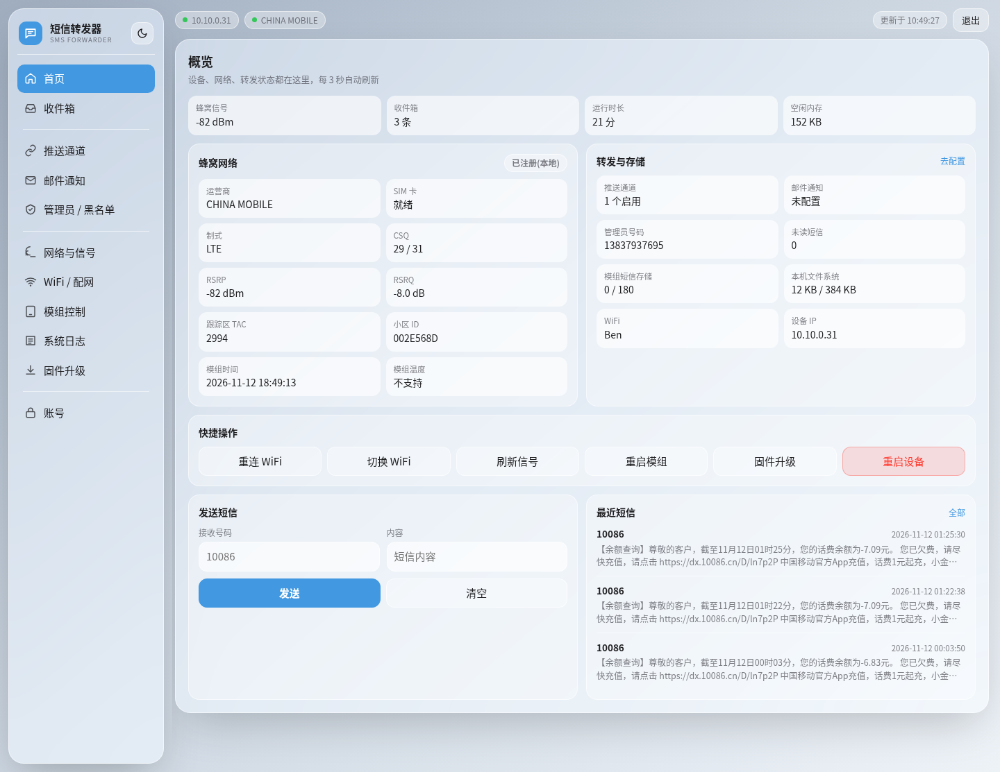
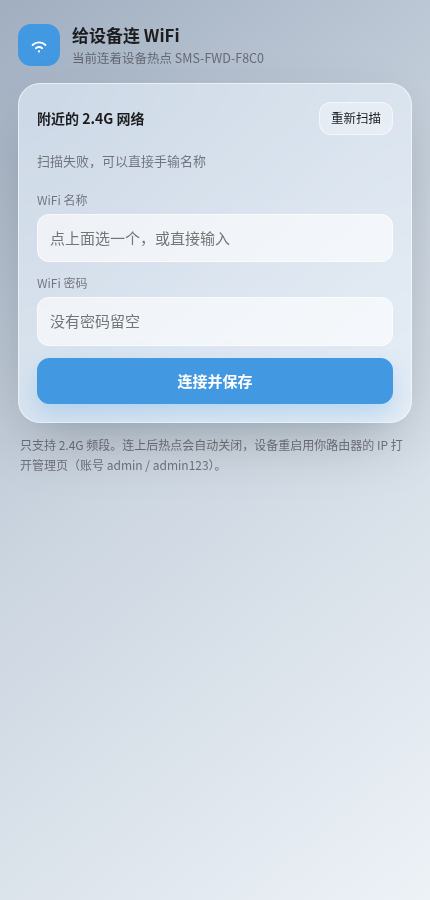
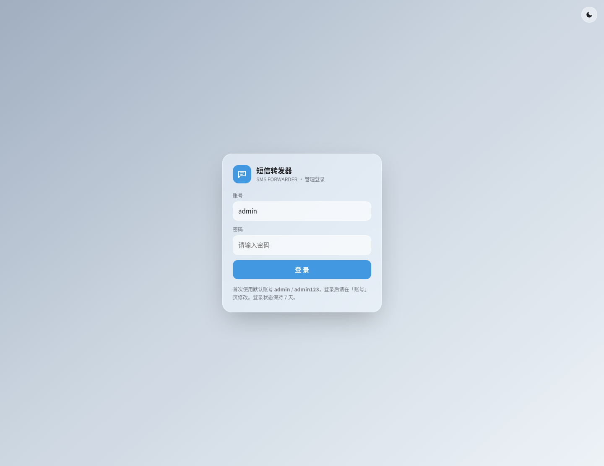
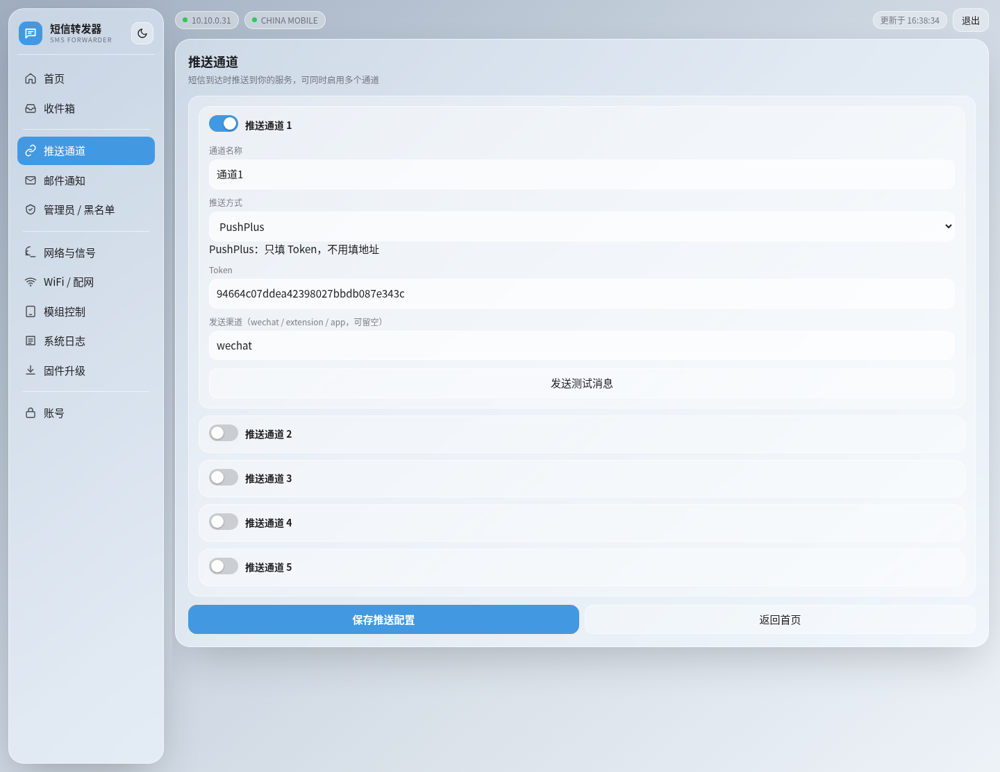
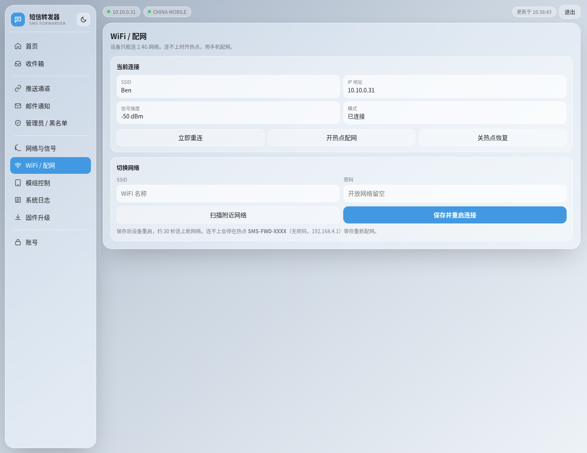

# 📨 SMS Forwarder

> An ESP32-C3 board with a 4G module that forwards incoming SMS to WeChat, email or any webhook.
> 一块 ESP32-C3 + 一张流量卡，把手机短信自动推到微信 / 邮件 / Webhook。


**[English](#-overview) · [中文](README.md)**



---

## 📖 Overview

Under $5 of hardware: an ESP32-C3 runs the web console and WiFi, an ML307R-DC module holds the SIM and receives SMS. Every incoming message is forwarded to WeChat (PushPlus / ServerChan / WeCom bot), email, Bark, Feishu, DingTalk or any HTTP endpoint, and archived in a local inbox on LittleFS.

No Arduino IDE required — download the **single `.bin`** from Releases and write it at `0x0` with one `esptool` command, then upgrade later by uploading the same `.bin` in the device's own web UI. Configuration and inbox survive upgrades; a firmware that fails to boot 3 times rolls back automatically.

---

## ✨ Features

- 📲 **No IDE needed** — the whole firmware is a **single `.bin`** written at `0x0`, bootloader and partition table included; no extra files to download
- 🔄 **Dual-slot OTA** — upload `.bin` from the web UI, keeps WiFi / push / SMTP / inbox; automatic rollback after 3 failed boots
- 📶 **Real provisioning** — after flashing the device is empty: it opens an open hotspot with a captive portal, the phone auto-pops the setup page
- 🧠 **No lost SMS** — single serial scheduler (URCs never race AT responses), multi-part SMS reassembly, modem storage auto-archived and drained
- ⚡ **Responsive main loop** — push and email go out from a dedicated background task, and sending SMS is a state machine, so a slow network never freezes the UI or drops messages
- 🗂️ **Local inbox** — 300 messages on LittleFS with paging, search, read flags and delete
- 🔀 **10 push back-ends** — up to 5 channels at once, fields adapt to the selected type, every channel has a "send test message" button
- 📮 **Email forwarding** — SMTP via ReadyMail, SSL / STARTTLS
- 🖥️ **Glassmorphism console** — dashboard aggregates everything plus quick actions and direct SMS sending; other features in their own tabs; light/dark themes, mobile-friendly
- 🔐 **Page login** — cookie session (HttpOnly, 7 days) plus double-submit CSRF validation, instead of the browser's native Basic-auth popup
- 🛡️ **Optional certificate pinning** — paste a TLS root CA and SMTP / HTTPS pushes really verify the chain; without one the UI says so plainly
- 📩 **Remote admin** — text `STATUS` / `WIFI` / `LOG` / `SMS:` / `RESET` / `HELP` from the admin number, results come back by email
- 🧪 **Network self-test** — modem-side `AT+MPING`, default target `223.5.5.5`, custom host and count
- 🛠️ **CI packaging** — pinned toolchain in GitHub Actions, tag pushes publish a Release

---

## 🚀 Quick Start

### 1️⃣ Hardware

| Part | Model | Required |
|---|---|---|
| MCU | ESP32-C3 SuperMini (4MB flash) | ✅ |
| 4G module | ML307R-DC core board (Nano SIM slot) | ✅ |
| Antenna | 4G FPC antenna on the module's IPEX connector | ✅ |
| SIM | China Mobile / Unicom / Telecom, SMS enabled | ✅ |

> 💡 No data plan needed to receive SMS. The network self-test uses a few KB of data; cellular data is disabled by default (`AT+CGACT=0,1`).

### 2️⃣ Wiring

```
┌───────────────────────────────────────────────┐
│   ESP32-C3 SuperMini      ML307R-DC board     │
│ ┌───────────────────┐    ┌─────────────────┐  │
└─┼─ GPIO5 (MODEM_EN) │    │                 │  │
  │       GPIO3 (TX) ─┼───►│ RX              │  │
  │                   │    │             EN ─┼──┘
  │       GPIO4 (RX) ◄┼────┤ TX              │
  │              GND ─┼────┤ GND             │
  │               5V ─┼────┤ VCC (5V)        │
  └───────────────────┘    └─────────────────┘
```

The ESP32 is powered and flashed over USB. The module keeps its factory AT firmware — nothing to flash there.

### 3️⃣ Flash

**Option A — Command line (recommended)**

```bash
# 1. Download sms_forwarding.bin from Releases
#    https://github.com/lzylipu/sms_forwarding/releases/latest
# 2. Write the whole image in one shot (COM4 on Windows, /dev/ttyACM0 on Linux/macOS)
esptool --chip esp32c3 -p /dev/ttyACM0 -b 460800 write-flash 0x0 sms_forwarding.bin
```

`sms_forwarding.bin` is a **whole-package** image: bootloader, partition table and application. Flash it at `0x0` and you are done — no separate files.

> 💡 A first flash overwrites everything on the device. Later upgrades go through "Firmware" in the web UI with the same `.bin`: only the app slot is rewritten, configuration and inbox are kept.

**Option B — Arduino CLI (build it yourself)**

```bash
arduino-cli core install esp32:esp32@3.3.10
arduino-cli lib install "pdulib@0.5.11" "ReadyMail@0.4.2"
arduino-cli compile --fqbn esp32:esp32:makergo_c3_supermini \
  --build-property "upload.maximum_size=1835008" --output-dir out ./code
```

### 4️⃣ Provisioning

A freshly flashed device has no WiFi credentials:

1. On power-up it **immediately** opens an open hotspot `SMS-FWD-XXXX`
2. The phone joining it auto-pops "Sign in to network" → that is the setup page; otherwise open `http://192.168.4.1`
3. The page scans automatically — pick a **2.4 GHz** network, type the password, tap connect
4. The device reboots onto your router, the hotspot closes, the page shows the new IP



> ⚠️ 2.4 GHz only. A 5 GHz SSID may show up in the scan but will not connect.

### 5️⃣ Sign in

Open the device IP → you land on the login page. Default user `admin`, default password `admin123`.

**Change it right away under "Account".** Sessions live in RAM, so a reboot means signing in again.



### 6️⃣ Add a push channel

"Push channels" → pick a type (e.g. PushPlus) → fill only what it needs (the Token) → press **Send test message** on that channel.

The page silently saves the form first, then makes the device send a real test message and reports success or failure — no need to wait for a real SMS.

Test messages are clearly labelled — title `[测试] 推送通道「通道1」连通正常` — and never masquerade as a real SMS. Real messages arrive as `短信来自: <number>` with a `短信时间` field. To preview exactly what a real SMS looks like on your phone, call `POST /push/test?ch=0&async=1&raw=1` (see [API docs](docs/API.md)).



---

## 🖥️ Web Console

The **dashboard** aggregates everything on one screen: signal, inbox count, uptime, free heap, carrier / SIM / RAT / CSQ / RSRP / RSRQ / TAC / cell ID / modem clock, forwarding and storage usage, six quick actions, a direct SMS form and the three most recent messages.

Everything else has its own tab: **Inbox / Push channels / Email / Admin & blacklist / Network & signal / WiFi / Modem control / Logs / Firmware / Account**.



- Light and dark themes, 22px rounded frosted-glass panels
- Buttons laid out on an `auto-fit` grid — never "three squeezed in a row, a fourth on its own line"
- On phones the sidebar becomes a horizontally scrollable text bar and cards stack

---

## 📮 Push & Email

| Type | Needs | Notes |
|---|---|---|
| POST JSON | endpoint URL | body `{sender,message,timestamp}` |
| Bark | Bark URL with key | iOS push |
| GET | full URL | parameters URL-encoded |
| DingTalk bot | webhook + optional secret | text message |
| PushPlus | token + optional channel `wechat/extension/app` | WeChat, HTML body |
| ServerChan | SendKey | WeChat, Markdown body |
| Telegram bot | chat ID + bot token | — |
| Gotify | server URL + app token | self-hosted |
| Feishu bot | webhook URL | text message |
| Custom template | URL + body template | `{sender}` `{message}` `{timestamp}` |

**Email**: SMTP with SSL/STARTTLS. Fill server / port / user / password / recipient and it is enabled; incomplete config is skipped and logged.

**TLS verification (optional)**: the email page has a "TLS root CA (PEM)" box shared by SMTP and HTTPS pushes:

- empty → encrypted but not verified; the UI says so explicitly
- pasted CA → `setCACert()`, full chain verification against man-in-the-middle

**Admin remote commands** (send an SMS to the device from the registered admin number):

| Command | Effect |
|---|---|
| `SMS:<number>:<text>` | device sends that SMS for you |
| `STATUS` | uptime, free heap, signal, inbox summary |
| `WIFI` | current WiFi and IP |
| `LOG` | last 20 log lines |
| `RESET` | reboot the device |
| `HELP` | list every command |

Every command replies **by email**, never by SMS (to avoid charges) — so remote admin needs SMTP configured.

---

## 🧪 Hardware Capability

Probed one by one with `AT+XXX=?` on a real device (ESP32-C3 SuperMini + ML307R-DC, module firmware `ML307R-DC-MBRH0S00`):

| Capability | Result | Notes |
|---|---|---|
| SMS send/receive, PDU mode | ✅ used | multi-part auto-assembled |
| Modem storage, 180 slots | ✅ used | drained automatically |
| Status reports `+CDS` | ✅ available | off by default |
| Cell / TAC / RAT | ✅ used | `+CEREG=2` URCs |
| Modem clock `+CCLK` | ✅ used | UTC + timezone quarter-hours |
| Chip temperature | ⚠️ unavailable | `+MCHIPINFO="temp"` returns `-1`, no sensor on this board |
| `MADC`, 2 channels | ✅ available | battery voltage / thermistor |
| `MGPIO`, 4 pins | ✅ available | relay, reed switch |
| `MLED` | ✅ available | module LED |
| `MNTP` / `MHTTP` / `MQTT` | ✅ available | module can go online by itself |
| Module FOTA | ✅ available | not used here |
| USSD (`*100#`) | ❌ unsupported | `+CUSD` → ERROR |
| Voice / caller ID | ❌ unsupported | `+CLIP` `+CLCC` `+CCWA` all ERROR |
| LBS positioning | ❌ unsupported | OpenCPU-only feature |
| GNSS | ❌ unsupported | no positioning hardware |
| `AT+CLAC` | ❌ unsupported | probe command by command |

> 📌 Scope is SMS receive + forward only. Multi-SIM, calls, dialing and public APIs are out of scope.

---

## 📁 Project Structure

```
sms_forwarding/
├── code/                    # Arduino firmware
│   ├── code.ino             # entry: init order, routes, main loop tasks
│   ├── modem.cpp/.h         # serial scheduler, AT I/O, URC parsing, SMS fetch
│   ├── sms_process.cpp/.h   # PDU decode, concatenation, dispatch
│   ├── sms_store.cpp/.h     # LittleFS inbox (JSONL, dedupe, compaction)
│   ├── push.cpp/.h          # 10 push back-ends + SMTP mail
│   ├── wifi_manager.cpp/.h  # NVS credentials, AP/STA, reconnect, watchdog
│   ├── portal.cpp/.h        # captive portal: wildcard DNS + probe redirects
│   ├── ota.cpp/.h           # dual-slot OTA, boot counter, rollback
│   ├── web_handlers.cpp/.h  # routes, session auth, chunked rendering
│   ├── web_html.cpp         # console page (inline CSS/JS, no CDN)
│   ├── web_pages_a.cpp      # login + provisioning pages
│   └── partitions.csv       # dual app slot layout
├── scripts/package.sh       # build output → single sms_forwarding.bin
├── docs/
│   ├── ARCHITECTURE.md      # architecture notes
│   ├── API.md               # HTTP API reference
│   └── REVIEW.md            # code review report (defects, evidence, known limits)
├── assets/                  # documentation screenshots
└── .github/workflows/build.yml
```

---

## ⚙️ Build & Release

```bash
# Local packaging (single .bin: flashable at 0x0, also accepted by in-device OTA)
bash scripts/package.sh out 2.1.6 dist
```

CI (`.github/workflows/build.yml`):

- pinned `esp32:esp32@3.3.10` / `pdulib@0.5.11` / `ReadyMail@0.4.2`
- every push compiles and uploads `sms_forwarding.bin` as an artifact
- a `v*` tag creates a Release with **that single `.bin`** — download it and write it at `0x0`

---

## 🔧 Troubleshooting

| Symptom | Cause & fix |
|---|---|
| `esptool` says `could not open port` | The port is held by another program: close serial monitors, the Arduino IDE, any other flasher. On Linux make sure your user is in `dialout` |
| Device keeps rebooting after flashing | Make sure you used the **whole-package** `.bin` from Releases and the offset was `0x0` — writing a bare app image to `0x0` will not boot |
| Hotspot joins but no setup page pops | Some Android builds do not probe. Open `http://192.168.4.1`, or any http site (the portal DNS redirects it) |
| WiFi scan finds nothing | 2.4 GHz only; you can also type the SSID manually. Make sure firmware ≥ 2.1.1 |
| Login succeeds but bounces back to login | Known bug in firmware < 2.1.2 (request headers not collected, cookie unreadable). Upgrade |
| Push never arrives | Press "send test message" on that channel, then check Logs for `[channel N] response code` and the platform body. Usually a wrong token or exhausted quota |
| Messages exist on the SIM but not in the UI | Check "modem storage" near 180 — a full modem silently refuses new SMS; the firmware drains it automatically |
| PushPlus delivers nothing | Fill the **Token** (not the topic), channel `wechat` |
| Modem temperature shows "unsupported" | No sensor on this board, expected |
| Config lost after upgrade | Only full-chip writes (offset 0x0) erase NVS. Uploading `.bin` via the web UI keeps everything |
| Sending SMS returns "network timeout (332)" | The carrier never acknowledged. Usually **the SIM is out of credit** or the carrier is throttling — not a firmware issue. Top up and it recovers immediately |
| Write actions return 403 "session token expired" | 2.1.6 CSRF protection: page sat too long, or you used curl. Reload the page; scripts must send `X-CSRF-Token` equal to `sid` |
| Nothing happens on save, log says "notify queue busy" | A push/email is in flight. Retry in a few seconds; more than 4 queued notifications drops the oldest one (logged) |

---

## 🗺️ Roadmap

- [x] Move push / SMTP to an async queue (2.1.6)
- [x] Async SMS sending state machine (2.1.6)
- [x] CSRF tokens and optional TLS root-CA verification (2.1.6)
- [x] Cap the log buffer (2.1.5)
- [x] More admin SMS commands (2.1.6)
- [ ] WebSocket instead of 3-second polling
- [ ] Unread indicator on the LED / buzzer

---

## 🤝 Contributing

Issues and PRs welcome. Before submitting:

1. `arduino-cli compile` passes (board `esp32:esp32:makergo_c3_supermini`)
2. No real WiFi credentials, tokens or private IPs — `code/wifi_config.h` holds placeholders only
3. UI changes come with desktop and mobile screenshots

---

## 📄 License

[MIT](LICENSE). Use, modify and sell freely; keep the copyright notice.

---

## 🙏 Acknowledgments

- ML307R-DC AT command reference from the vendor manual
- Libraries: [pdulib](https://github.com/mgaman/PDUlib) (PDU codec), [ReadyMail](https://github.com/mobizt/ReadyMail) (SMTP), [arduino-esp32](https://github.com/espressif/arduino-esp32)
- The first version of this idea came from the open-source project [chenxuuu/sms_forwarding](https://github.com/chenxuuu/sms_forwarding) (MIT). This project rewrites the UI, provisioning, OTA, inbox and stability work on top of it, and keeps the original copyright notice as MIT requires — see `LICENSE`
